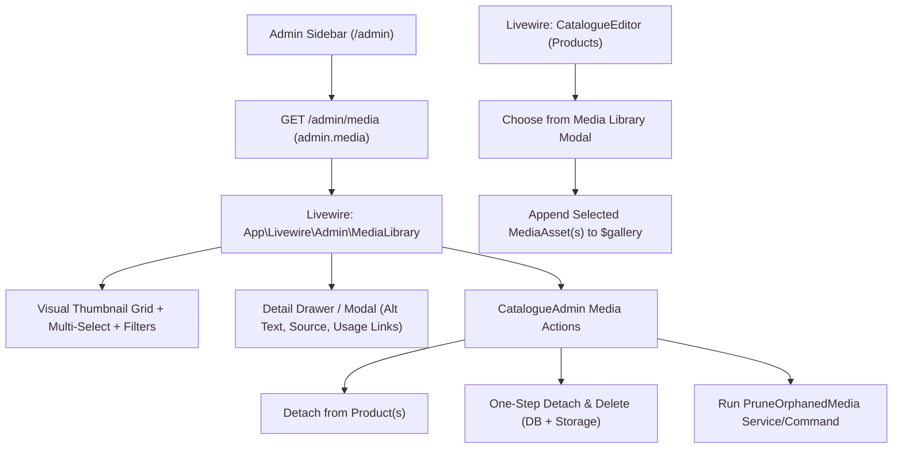

# WordPress-Style Admin Media Library & Product Media Picker Plan

## 1. Goal & Context

When auditing product pages such as `Hustler LM100 Softhands Bale Handler` (`/machinery/hustler-lm100-softhands-bale-handler`), a client reference photo of a laptop screen (`whatsapp-image-2026-11-10-at-756-01a1c97d-f831-7097-bf05-3eb8601212cb.jpeg`) was found at gallery position `[9]`. Currently, `/admin` only displays images inside individual Product, Category, or Brand edit screens, making it difficult to visually scan all uploaded/imported media across the website, see which products use a given image, or remove unwanted screenshots in bulk.

This plan introduces a **WordPress-style Admin Media Library (`/admin/media`)** and a **"Choose from Media Library" modal picker for Products**, integrated with the existing `MediaAsset` model, `CatalogueAdmin` service, and `PruneOrphanedMedia` command (`catalogue:prune-orphaned-media`).

---

## 2. Database Audit of WhatsApp / Feedback Images

An audit of `media_assets` identified **28 records** originating from `docs/feedbacks/images/` or matching `whatsapp`:

### A. Attached Laptop Screen Photo (To Detach & Delete)
| MediaAsset ID | Product | Gallery Index | Storage Path | Notes |
| :--- | :--- | :---: | :--- | :--- |
| `01a1c97d-f844-7245-8ec2-e2a8a2cf05d6` | **Hustler LM100 Softhands Bale Handler** (`hustler-lm100-softhands-bale-handler`) | `[9]` | `products/2026/11-11/01a1c97a-d44e-738c-b662-9a69845bf08a/whatsapp-image-2026-11-10-at-756-01a1c97d-f831-7097-bf05-3eb8601212cb.jpeg` | Photo of client's HP laptop screen (`WhatsApp Image 2026-11-10 at 7.56.13 AM.jpeg`). Product already has 9 official Hustler images (`[0]`–`[8]`). |

### B. Orphaned / Detached WhatsApp Photos (14 Records — Ready to Prune)
These 14 records were detached from MultiOne and Pöttinger products when official manufacturer images were applied, and have **no product attachments**:
- `01a1c5d4-a319-7150-8f9c-63d4c3dcdbd7` (`WhatsApp Image 2026-11-10 at 7.50.52 AM.jpeg`)
- `01a1c5d4-a32c-71e2-9b42-13a85d1dc1b7` (`WhatsApp Image 2026-11-10 at 7.50.53 AM.jpeg`)
- `01a1c9e2-a354-7010-af57-46277b0559b7` (`WhatsApp Image 2026-11-10 at 8.00.24 AM.jpeg`)
- `01a1c9e2-a3b3-70b7-b73e-4ce2a67c4afc` (`WhatsApp Image 2026-11-10 at 7.59.56 AM.jpeg`)
- `01a1c9e2-a3c8-71a8-bad0-9a1ebdc8b564` (`WhatsApp Image 2026-11-10 at 8.00.24 AM.jpeg`)
- `01a1c9e2-a427-7361-991e-74cc90a2604a` (`WhatsApp Image 2026-11-10 at 8.01.15 AM.jpeg`)
- `01a1c9e2-a444-7362-810f-7344d17c7aa3` (`WhatsApp Image 2026-11-10 at 8.01.16 AM.jpeg`)
- `01a1c9e2-a462-7027-b309-1c0ae8360a15` (`WhatsApp Image 2026-11-10 at 8.00.24 AM.jpeg`)
- `01a1c9e2-a4cb-72b1-b063-d579c66d4942` (`WhatsApp Image 2026-11-10 at 8.00.24 AM.jpeg`)
- `01a1c9f2-230f-72b5-8e76-7e3cf7558bd5` (`WhatsApp Image 2026-11-10 at 8.01.40 AM.jpeg`)
- `01a1c9f2-2337-7357-bd96-757e46465adb` (`WhatsApp Image 2026-11-10 at 8.02.09 AM.jpeg`)
- `01a1c9f2-2418-727c-8e4a-c9bf12b78beb` (`WhatsApp Image 2026-11-10 at 8.02.56 AM.jpeg`)
- `01a1c9f2-2431-72d6-a888-e9c0f52b828d` (`WhatsApp Image 2026-11-10 at 8.00.24 AM.jpeg`)
- `01a1c9f2-24f9-705b-bcd9-f22d110d2d1e` (`WhatsApp Image 2026-11-10 at 8.02.57 AM.jpeg`)

### C. Genuine Depot Yard Photos (13 Records — Keep Attached)
These are real photographs taken in Henry Porter Machinery's yard/depot and are intentionally used on their respective machines:
- **Hustler Unrolla LX104 Bale Feeder** (`hustler-unrolla-lx104-bale-feeder`): 6 depot yard photos (`7.55.39 AM` – `7.55.42 AM`) in front of the Henry Porter Machinery sign.
- **Johnston Silo Shear Grabs** (`johnston-shear-grabs`): 1 depot yard photo (`7.58.30 AM`).
- **Novacat V8400 ED Butterfly Mowers** (`novacat-v8400-ed-butterfly-mowers`): 2 depot/shed photos (`8.02.10 AM (1)`, `8.02.34 AM`).
- **TOP VT 12540 C** (`top-vt-12540-c`): 4 depot yard photos (`8.03.31 AM` – `8.03.54 AM (1)`).

---

## 3. Architecture & Proposed Changes



---

### Component 1: Model & Service Layer Enhancements

#### [MODIFY] `app/Models/MediaAsset.php`
Add helper relations and query scopes so the Media Library can efficiently eager-load usage counts and filter by source or attachment state:
- `brandsAsImage()`: `hasMany(Brand::class, 'image_media_id')->withTrashed()`
- `brandsAsLogo()`: `hasMany(Brand::class, 'logo_media_id')->withTrashed()`
- `categoriesAsImage()`: `hasMany(Category::class, 'image_media_id')->withTrashed()`
- `scopeFilterSource($query, string $source)`:
  - `'whatsapp_local'`: `storage_path LIKE '%whatsapp%'` or `source_path LIKE 'local:%'`
  - `'remote_web'`: `source_path LIKE 'http%'`
  - `'admin_upload'`: `source_path IS NULL`
  - `'legacy_joomla'`: `storage_path LIKE 'legacy/%'` or `source_path LIKE 'images/virtuemart/%'`
- `scopeFilterAttachment($query, string $status)`:
  - `'attached'`: attached to at least one product, brand, or category
  - `'unattached'`: not in `product_media`, `brands.image_media_id`, `brands.logo_media_id`, or `categories.image_media_id`
  - `'products'`: `whereHas('products')`
  - `'brands_categories'`: `whereHas('brandsAsImage')->orWhereHas('brandsAsLogo')->orWhereHas('categoriesAsImage')`

---

#### [MODIFY] `app/Services/Catalogue/CatalogueAdmin.php`
1. **Allow Attaching Existing Media Library Assets to Products**:
   In `CatalogueAdmin::save()` (lines 166–177), `$allowed` currently restricts `$gallery` items to media already attached to `$record`:
   ```php
   // Current:
   $allowed = $record->media()->pluck('media_assets.id')->all();
   ```
   Update this logic so any existing `MediaAsset` ID in `media_assets` can be attached to the product's gallery while still tracking `$previouslyAttachedIds` so detached assets are passed to `purgeAssetIfOrphaned()`:
   ```php
   $previouslyAttachedIds = $record->media()->pluck('media_assets.id')->all();
   $links = [];
   $retainedIds = [];
   foreach ($gallery as $index => $image) {
       $asset = MediaAsset::whereKey($image['id'])->first();
       if (! $asset) {
           throw ValidationException::withMessages(['gallery' => 'Selected media asset does not exist.']);
       }
       $asset->update(['alt_text' => $image['alt_text'] ?? '', 'admin_modified_at' => now()]);
       $links[$asset->id] = ['sort_order' => $index];
       $retainedIds[] = $asset->id;
   }
   // ... handle new file uploads ...
   $record->media()->sync($links);
   $detachedIds = array_diff($previouslyAttachedIds, $retainedIds);
   foreach ($detachedIds as $detachedId) {
       $this->purgeAssetIfOrphaned($detachedId, $toDelete);
   }
   ```

2. **Add Media Library Management Methods to `CatalogueAdmin`**:
   - `updateMediaMetadata(string $assetId, array $data): MediaAsset`: Validates and updates `title` and `alt_text` on a `MediaAsset`.
   - `detachMediaFromProduct(string $assetId, string $productId): void`: Removes the pivot row in `product_media`, re-normalizes remaining `sort_order` values (0, 1, 2...) on that product, and marks `$product->admin_modified_at = now()`.
   - `deleteMediaAssets(array $assetIds, bool $detachFirst = true): array{deleted: int, skipped_protected: int}`:
     - Inside a transaction, if `$detachFirst` is true, detaches the asset IDs from `product_media`, nulls out any `brands.image_media_id` / `logo_media_id` and `categories.image_media_id`.
     - Skips deleting files on disk if `$asset->isProtectedLegacy()` or if the path is still embedded in HTML descriptions (`isReferenced()`), otherwise deletes the `MediaAsset` row and removes the physical file from `Storage::disk('public')`.
   - `uploadToLibrary(array $files): list<MediaAsset>`: Allows uploading standalone images directly from `/admin/media` into `library/YYYY/MM-DD/` (or attaching them later to products).

---

### Component 2: WordPress-Style Admin Media Library (`/admin/media`)

#### [NEW] `app/Livewire/Admin/MediaLibrary.php`
A full-page Livewire 4 component (`#[Layout('layouts.app')]`) providing:
- **State & Filters**:
  - `$search = ''` (searches `title`, `alt_text`, `storage_path`, `source_path`)
  - `$brand = ''` (filters media attached to products of a specific brand)
  - `$product = ''` (filters media attached to a specific product)
  - `$attachment = ''` (`all`, `attached`, `unattached`, `products`, `brands_categories`)
  - `$source = ''` (`all`, `whatsapp_local`, `remote_web`, `admin_upload`, `legacy_joomla`)
  - `$perPage = 36`
- **Selection & Bulk Actions**:
  - `$selected = []` (array of selected `MediaAsset` UUIDs)
  - `selectAllOnPage()`, `clearSelection()`
  - `bulkDetachFromProducts()`: Detaches all `$selected` assets from products without deleting the files.
  - `bulkDelete()`: Performs one-step Detach & Delete on all `$selected` assets and shows a summary toast.
- **Detail Inspector Drawer / Modal**:
  - `$inspectingId = null`
  - `inspect(string $id)`: Loads the `MediaAsset` along with its `products` (including `pivot.sort_order`), `brandsAsImage`, `brandsAsLogo`, and `categoriesAsImage`, plus `$inspectTitle` and `$inspectAltText`.
  - `saveMetadata()`: Saves updated `title` and `alt_text`.
  - `detachFromProduct(string $assetId, string $productId)`: Detaches the asset from a single product right from the inspector.
  - `deleteSingle(string $assetId)`: One-step Detach & Delete for the inspected asset.
- **Orphan Prune Integration**:
  - `pruneOrphans()`: Calls `Artisan::call('catalogue:prune-orphaned-media', ['--apply' => true])` and flashes the command output.

#### [NEW] `resources/views/livewire/admin/media-library.blade.php`
- **Header Bar**: Title ("Media Library"), total asset count, **"Prune Orphaned Media"** action button, and **"Upload Images"** button.
- **Filter Bar**:
  - Search input (`wire:model.live.debounce.300ms="search"`)
  - Source dropdown (`All Sources`, `WhatsApp / Local Imports`, `Remote Web URLs`, `Admin Uploads`, `Legacy Joomla`)
  - Attachment Status dropdown (`All Media`, `Attached to Products`, `Brands / Categories`, `Unattached / Orphaned`)
  - Brand dropdown & Product dropdown
- **Bulk Action Toolbar** (visible when `count($selected) > 0`):
  - Shows `X images selected`
  - **"Detach from Products"** button (`wire:confirm`)
  - **"Detach & Delete Permanently"** button (`wire:confirm` listing how many attached products will be updated)
  - **"Clear Selection"** button
- **Visual Grid**:
  - Responsive grid (`grid-cols-2 sm:grid-cols-3 md:grid-cols-4 lg:grid-cols-6 gap-4`).
  - Each card displays:
    - Top-left checkbox for multi-select.
    - Top-right badge indicating usage count (e.g. `1 Product · Cover`, `1 Product · #10`, or amber `Unattached` badge, or `WhatsApp` badge when `storage_path` contains `whatsapp`).
    - Aspect-square thumbnail (`object-contain bg-white p-2`).
    - Filename / title and linked product name underneath.
    - Clicking the thumbnail opens the **Detail Inspector Modal**.
- **Detail Inspector Modal**:
  - Full-resolution preview link, storage path, source URL/path, MIME type, checksum.
  - Form inputs for `Title` and `Alt Text` with `Save details`.
  - **"Used In" Section**:
    - Lists every Product using this image, showing whether it is the **Cover image** (`sort_order = 0`) or **Gallery image #N**, with:
      - Link to `route('admin.catalogue.edit', ['products', $product->id])`
      - **"Detach"** button (`wire:click="detachFromProduct('{{ $asset->id }}', '{{ $product->id }}')"`)
  - **"Detach & Delete Permanently"** button at the bottom of the inspector with confirmation.

---

### Component 3: "Choose from Media Library" Picker in Product Editor

#### [MODIFY] `app/Livewire/Admin/CatalogueEditor.php`
Add Media Library modal picker state and actions for Products:
- `public bool $mediaPickerOpen = false;`
- `public string $mediaPickerSearch = '';`
- `public string $mediaPickerSource = '';`
- `public array $mediaPickerSelected = [];`
- `openMediaPicker(): void`: Resets `$mediaPickerSelected = []` and opens the modal.
- `toggleMediaPickerAsset(string $assetId): void`: Toggles an asset UUID in `$mediaPickerSelected`.
- `attachSelectedMedia(): void`:
  - Fetches `MediaAsset::whereIn('id', $this->mediaPickerSelected)->get()`.
  - Skips any asset ID already in `$this->gallery`.
  - Appends each selected asset to `$this->gallery` as `['id' => $m->id, 'alt_text' => $m->alt_text ?? '', 'url' => $m->url(), 'mime_type' => $m->mime_type]`.
  - Closes the modal (`$this->mediaPickerOpen = false`).

#### [MODIFY] `resources/views/livewire/admin/catalogue-editor.blade.php`
- In the Product Images / Gallery panel:
  - Alongside the `<input type="file" wire:model="images" multiple>` control, add a secondary button: **"Choose from Media Library"** (`wire:click="openMediaPicker"`).
  - Render the Media Picker modal when `$mediaPickerOpen` is true:
    - Search input and Source filter.
    - Paginated or scrollable grid of `MediaAsset` thumbnails (marking any image already in `$gallery` as "Already attached").
    - Footer with **"Add selected images ({{ count($mediaPickerSelected) }})"** button (`wire:click="attachSelectedMedia"`).

---

### Component 4: Routes, Navigation & Styling

#### [MODIFY] `routes/web.php`
Inside the `Route::middleware(['auth', 'verified', 'can:manage-catalogue'])->prefix('admin')->name('admin.')->group(...)` block:
```php
Route::get('/media', \App\Livewire\Admin\MediaLibrary::class)->name('media');
```

#### [MODIFY] `resources/views/layouts/app/sidebar.blade.php`
Add **Media Library** to the `Catalogue` sidebar group right below `Brands` (and before `Import / Export`):
```blade
<flux:sidebar.item icon="photo" :href="route('admin.media')" :current="request()->routeIs('admin.media')" wire:navigate>Media Library</flux:sidebar.item>
```

#### [MODIFY] `public/css/admin.css`
Add clean browser-ready CSS classes for the media grid cards, selection rings, usage badges, and inspector drawer/modal layout (no Tailwind rebuild needed for custom admin CSS).

#### [MODIFY] `docs/catalogue-admin.md`
Document the new `/admin/media` Media Library, filters, one-step detach/delete, and the Product Media Library picker.

---

## 4. Verification & Testing Plan

### Automated Feature Tests
Create `tests/Feature/AdminMediaLibraryTest.php` covering:
1. **Access Control**: Guests and non-admin users receive `403`/`302` on `/admin/media`; verified admins receive `200`.
2. **Filtering & Search**:
   - Filtering by `$source = 'whatsapp_local'` returns the WhatsApp `MediaAsset` records.
   - Filtering by `$attachment = 'unattached'` returns only orphaned `MediaAsset` records.
   - Filtering by `$product` returns only media attached to that product.
3. **One-Step Detach & Delete**:
   - Deleting an attached `MediaAsset` (such as the laptop photo on `Hustler LM100 Softhands Bale Handler`) removes its pivot row from `product_media`, deletes the `MediaAsset` record, and deletes the file from `Storage::disk('public')`.
4. **Bulk Detach & Bulk Delete**:
   - Selecting multiple `MediaAsset` IDs detaches and deletes them in one action while preserving protected legacy files (`catalogue/joomla/`).
5. **Product Editor Media Picker**:
   - Calling `toggleMediaPickerAsset()` and `attachSelectedMedia()` on `CatalogueEditor` appends existing `MediaAsset` items to `$gallery`, and `save()` persists the `product_media` relation.

### Exact Commands to Run in Next Chat
```bash
# 1. Run the new feature tests
php artisan test --compact --filter=AdminMediaLibraryTest

# 2. Run existing admin & catalogue tests to confirm no regressions
php artisan test --compact --filter=CatalogueAdminTest

# 3. Check formatting with Laravel Pint
php vendor/bin/pint app/Models/MediaAsset.php app/Services/Catalogue/CatalogueAdmin.php app/Livewire/Admin/MediaLibrary.php app/Livewire/Admin/CatalogueEditor.php tests/Feature/AdminMediaLibraryTest.php --test
```

### Immediate Cleanup Steps (Local & Staging)
Once `/admin/media` is built (or via CLI):
1. Open `/admin/media?source=whatsapp_local` to visually inspect all 28 WhatsApp/feedback images.
2. Select the laptop screen image (`whatsapp-image-2026-11-10-at-756-01a1c97d-f831-7097-bf05-3eb8601212cb.jpeg`) on **Hustler LM100 Softhands Bale Handler** and click **Detach & Delete**.
3. Click **Prune Orphaned Media** to remove the 14 unattached WhatsApp images from disk and database.
